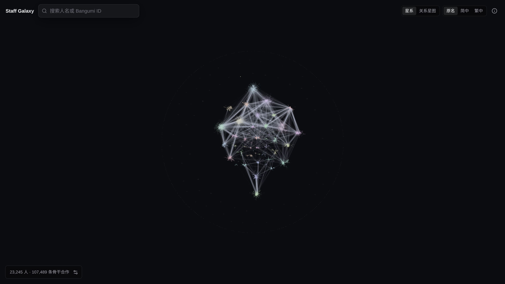
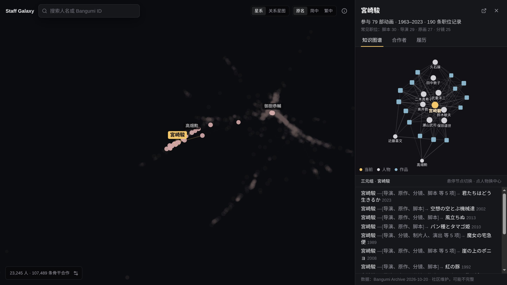

# StaffGalaxy

日本动画制作人员的合作星图。每个点是一位制作人员，每条线是两人之间统计上显著的合作关系；点开一个人，就能看到他参与过哪些作品、和谁合作最多，以及任意两个人之间隔着几个人。

数据来自 [Bangumi](https://bgm.tv) 社区维护的 [Bangumi Archive](https://github.com/bangumi/Archive)，存放在 Neo4j 知识图谱里。





## 能做什么

- **星系**：两万多位主要制作人员，按合作关系自动聚成圈子。搜索一个人，画面会直接移到他身上。
- **局部知识图谱**：以某人为中心的「人—作品」关系图，下方列出对应的三元组，比如「宮崎駿 —[导演、脚本]→ 千と千尋の神隠し」。点另一个人即可换中心。
- **合作者与履历**：骨干合作者列表，展开能看到两人具体在哪些作品里各担任什么职位；完整履历保留原始职位名称。
- **关系星图**：输入两个人，找出他们之间的最短合作路径。例如新海诚到宫崎骏只隔一个人。
- **搜索**：支持 Bangumi ID、原名、简体、繁体、别名、罗马字和模糊匹配，输入「宫崎骏」能找到「宮崎駿」。

## 原理

**知识图谱。** 存储层是 Neo4j 属性图：

```
(:Person)-[:CREDITED {职位, 档位, 权重}]->(:Anime)
(:Person)-[:VOICED]->(:Character)-[:APPEARS_IN]->(:Anime)
```

职位直接写在关系上，不需要像 RDF 那样为每次参与额外造节点。177 种职位按重要程度分为 S / A / B / C / D / E / F 七档（见 `staff_galaxy/roles.py`）。

**星系里的线是怎么选的。** 只要一起出现过就连线的话，会有 165 万对，而且越高产的人和谁都能撞上几部。所以这里用二分图配置模型（BiCM，Saracco 等 2017）做显著性检验：保留每个人参与的作品数和每部作品的人数，其余随机，算出两人随机情况下的期望合作次数，实际明显更多才连线。对全部人员两两配对做 Benjamini–Hochberg 校正（FDR 5%），再补上最大生成森林，让只合作过一两部的人也不会孤立。最终保留 107,489 条（见 `staff_galaxy/visible_edges.py`）。

例如宫崎骏和久石让：随机期望合作 0.19 部，实际 16 部。

**布局。** 用 Leiden 算法划分社区，社区之间和社区内部分别做力导向布局（见 `staff_galaxy/layout.py`）。前端用 [cosmos.gl](https://github.com/cosmosgl/graph) 在 WebGL 中渲染，会根据帧率自动调节画质。

## 数据与版权

- 所有人物、作品和职位数据来自 [Bangumi Archive](https://github.com/bangumi/Archive)，版权归 Bangumi 及其贡献者所有。
- **本仓库只包含代码，不包含也不分发任何 Bangumi 数据。** 运行前需要自行下载数据包（见下文）。
- 数据由社区维护，可能有缺漏或错误；发现问题请到 Bangumi 对应条目修正。

## 快速开始

需要：Docker、Python 3.12+、Node.js 20.19+。

### 1. 安装

```bash
python3 -m venv .venv
.venv/bin/pip install -e .
cd frontend && npm install && cd ..
cp .env.example .env    # 然后把 NEO4J_PASSWORD 改成你自己的密码
```

### 2. 启动 Neo4j

```bash
docker compose up -d neo4j
```

Neo4j Browser 在 <http://localhost:7474>，数据存放在 `data/processed/neo4j/`。

### 3. 下载数据

```bash
mkdir -p data/raw/bangumi-archive/aux data/raw/bangumi-common

# 最新数据包的元信息，里面带着下载地址
curl -L -o data/raw/bangumi-archive/aux/latest.json \
  https://raw.githubusercontent.com/bangumi/Archive/master/aux/latest.json

# 数据包本体（约 450 MB）
curl -L --output-dir data/raw -O \
  "$(python3 -c 'import json; print(json.load(open("data/raw/bangumi-archive/aux/latest.json"))["browser_download_url"])')"

# 职位编号与名称的对照表
curl -L -o data/raw/bangumi-common/subject_staffs.yml \
  https://raw.githubusercontent.com/bangumi/common/master/subject_staffs.yml
```

### 4. 建图

```bash
.venv/bin/python -m staff_galaxy.cli
```

这一步会清空 Neo4j 里的现有数据，然后导入数据包并计算星系（合作关系筛选、社区划分、布局、搜索词），同时在 `reports/data-audit.md` 生成一份数据统计。

只改了职位权重或布局算法时，不必重新导入：

```bash
.venv/bin/python -m staff_galaxy.cli --derived-only
```

### 5. 运行

```bash
# 后端（需要 Neo4j 已启动）
.venv/bin/uvicorn staff_galaxy.api:app --host 127.0.0.1 --port 8000

# 前端（另开一个终端）
cd frontend && npm run dev
```

打开 <http://127.0.0.1:5173/>。可以直接分享的链接：

```text
/person/1040                    # 某个人
/path?from=2064&to=1040         # 两人之间的最短路径
/compare?from=1040&to=1638      # 两人的共同作品
```

数字是 Bangumi 的人物 ID。前端开发服务器会把 `/api` 代理到 `127.0.0.1:8000`。生产构建用 `npm run build`，然后 `npm run preview` 预览。

## API

| Endpoint | 用途 |
|---|---|
| `GET /api/manifest` | 数据快照信息和星系规模 |
| `GET /api/graph/buffers` | 星系的二进制几何数据（位置、大小、社区、边） |
| `GET /api/graph/meta` | 星系节点的名字和度数 |
| `GET /api/search/persons?q=...` | 搜索人物 |
| `GET /api/person/{id}/detail` | 人物摘要、常见职位、近期作品 |
| `GET /api/person/{id}/credits` | 完整履历 |
| `GET /api/person/{id}/galaxy` | 骨干合作者 |
| `GET /api/person/{id}/knowledge-graph` | 局部知识图谱 |
| `GET /api/collaboration/{a}/{b}` | 两人的共同作品 |
| `GET /api/path/{a}/{b}` | 两人之间的最短合作路径 |

## 测试

测试使用一个独立的、会被清空的 Neo4j 实例（端口 7688），不影响主图谱：

```bash
docker compose --profile test up -d neo4j-test
.venv/bin/python -m unittest -v tests.test_api_complete_graph
cd frontend && npm run lint && npm run build
```

## 许可证

代码以 [MIT](LICENSE) 许可证发布。数据的版权见上文「数据与版权」。
